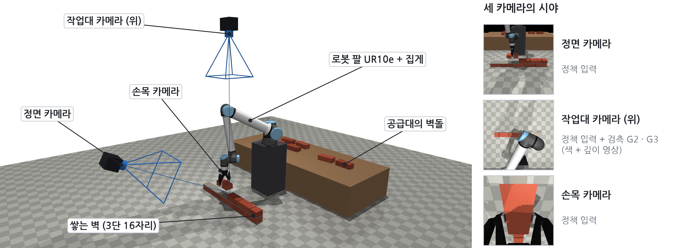
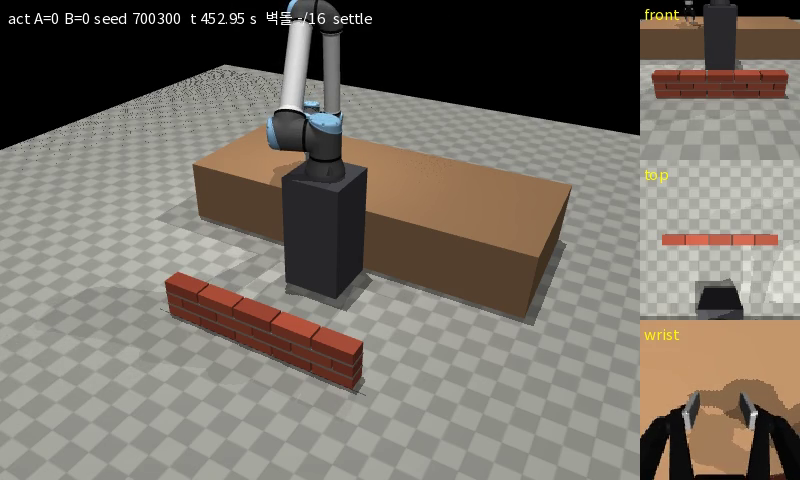
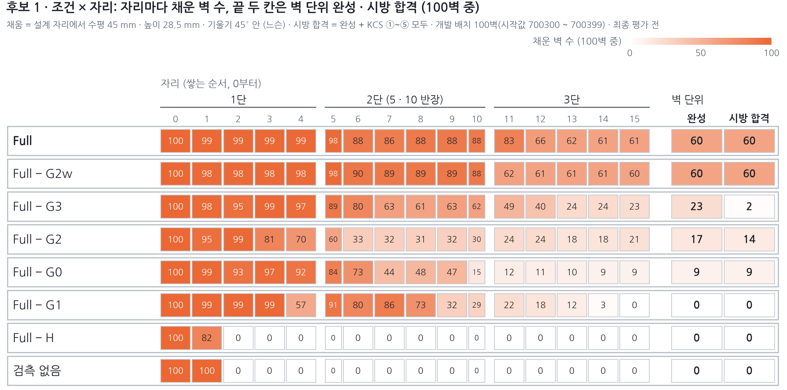

# 모방학습 정책 + 검측 제어로 벽돌 쌓기

[](https://github.com/wonyoungjacob/masonry-inspection-il/actions/workflows/tests.yml)

**Imitation-learned policy + inspection control for a three-course masonry wall** · MuJoCo · UR10e + Robotiq 2F-140 · LeRobot ACT
연세대 건설환경공학과 2026-2 사회기반시스템종합설계 (스마트인프라연구실)

> 시연으로 학습한 ACT 정책만으로는 표준 벽돌 3단 16장 벽을 하나도 완성하지 못했다(벽돌 성공 12.5 %).
> 실패를 동작 단위로 추적해 원인마다 대책을 하나씩 더했고, 같은 벽체 100개에서 매번 짝 비교로 효과를 쟀다.
> 최종 구성은 **벽돌 1,600 / 1,600장 성공, 벽 완성 100 / 100, 시공 허용오차(KCS 41 34 00) 합격 96 / 100** 이다.
> 로봇 제어에는 도면 · 카메라 · 로봇 센서만 쓰고, 시뮬레이터의 정답 좌표는 채점에만 썼다.

| 실험 환경 | 최종 구성으로 완성한 벽 (시작값 700300) |
|---|---|
|  |  |

모든 수치는 **시뮬레이션 · 개발 배치 100벽(시작값 700300 ~ 700399)** 결과다. 따로 떼어 둔 시험 배치로는 아직 재지 않았다. [한계](#한계) 참고.

---

## 문제

- 조적은 벽돌을 순서대로 쌓으므로 **한 장의 실패가 벽 전체의 실패**가 된다.
- 성공 시연만 학습한 정책은 잘못 집거나 놓아도 알아채지 못하고 그럴듯한 동작을 이어 간다.
- 로봇 분야의 성공률은 시공 품질을 말해 주지 않는다. 그래서 결과를 **표준시방서의 시공 허용오차 5항목**으로도 판정했다.

## 쌓기 제어 체계 (최종 구성)

정책은 다음 벽돌을 고르고 공급 칸으로 손을 가져간다. mm 정밀도가 필요한 구간은 측정값으로 움직이는 검측 제어가 맡는다.

| 작업 | 담당 | 쓰는 정보 |
|---|---|---|
| 다음 벽돌 선택, 공급 칸 접근 | 정책 (ACT) | 카메라 3대(128²), 관절 상태, 현재 차례의 도면 목표 |
| 집기 | **G0v** | 손목 카메라 |
| 쥐었는지 확인 | **G1** | 손목 힘 센서, 집게 각도 |
| 든 벽돌의 목표 결정 | **H** | 도면, 관절값 (쥔 순간 가장 가까운 공급 칸) |
| 운반 | **G2t** | 도면, 관절값 |
| 놓기 전 보정 | **G2 · G2w** | 작업대 RGB-D 카메라 |
| 놓은 뒤 확인 · 재배치 | **G3** | 작업대 RGB-D 카메라 |

## 설계 과정: 13 % → 100 %

한 번에 하나만 바꾸고 같은 100벽에서 다시 쟀다. 구간은 직전 단계 대비 벽 단위 부트스트랩(10,000회) 95 % 신뢰구간이다.

| 단계 | 바꾼 것 (찾은 원인) | 벽돌 성공 | 완성 /100 | 시방 합격 /100 | 직전 대비 벽돌 성공 (%p) |
|---|---|---:|---:|---:|---|
| ① | 처음 학습한 정책 + G1 · G2 · G3 | 13.0 % | 0 | 0 | – |
| ② | **시연 손목 방향 통일** 후 재학습 — 대칭 벽돌이라 시연의 손목 방향이 505 : 495로 갈려, 정책이 평균을 내 대각선으로 쥠 | 33.6 % | 0 | 0 | +20.6 [+18.6, +22.6] |
| ③ | **+ H** — 정책이 차례를 건너뛰어(81벽) 검측이 엉뚱한 자리 기준으로 보정함 | 53.4 % | 12 | 11 | +19.8 [+15.9, +23.9] |
| ④ | **+ G0** — 정책이 공급 벽돌 중심에서 3 ~ 4 cm 벗어난 곳을 겨눠 넘어뜨림 | 83.1 % | 59 | 59 | +29.7 [+23.3, +35.9] |
| ⑤ | + G2w (전체 구성) | 85.3 % | 60 | 60 | +2.2 [−0.5, +4.9] 유의차 없음 |
| ⑥ | **+ G2t** — 남은 실패가 정책의 운반 구간에 몰림 | 91.4 % | 83 | 79 | +6.1 [−0.1, +12.2] (완성 +23 %p [+10, +36]) |
| ⑦ | **G0 → G0v** (손목 카메라로 재서 집기) + 무게 보상의 참값 위치 제거 | **100 %** | **100** | **96** | +8.6 [+4.6, +13.1] |
| 참고 | ② 정책에서 검측을 모두 끔 | 12.5 % | 0 | 0 | |

- 벽돌 성공 = 설계 자리에서 수평 45 mm · 높이 28.5 mm 안, 기울기 45° 미만(자리에 있는가). 정밀도는 시방 5항목이 판정한다.
- 최종 구성의 벽돌별 3D IoU 평균 0.984. 허용 범위(모서리가 수평 6 mm · 높이 3 mm 안) 안이 보장되는 벽돌 1,590 / 1,600장.
- 불합격 4벽은 16장을 다 쌓았지만 ② 선 및 면 · ③ 수직도가 6 mm를 넘었다. 원인은 아직 확인하지 못했다.
- ⑦에는 두 변경이 함께 들어 있어 각각의 기여는 나누지 못했다. 단계마다 실행한 날짜가 달라 그 사이 코드도 바뀌었다(초기 조건은 같음).

## 단계별 기여도 (역방향 제거, ⑤ 기준)

전체 구성 ⑤에서 단계를 하나씩 빼고 같은 100벽에서 짝 비교했다.

| 뺀 단계 | 벽돌 성공 | 완성 | 시방 합격 | 차이 (%p) [95 %] | 판정 |
|---|---:|---:|---:|---|---|
| 없음 (⑤) | 85.3 % | 60 | 60 | – | – |
| H | 11.4 % | 0 | 0 | −73.9 [−77.9, −69.7] | 유의한 감소 |
| G2 (G2w 포함) | 48.0 % | 17 | 14 | −37.3 [−43.6, −31.0] | 유의한 감소 |
| G0 | 52.7 % | 9 | 9 | −32.6 [−38.8, −26.1] | 유의한 감소 |
| G1 | 56.3 % | 0 | 0 | −29.1 [−33.8, −23.9] | 유의한 감소 |
| G3 | 66.7 % | 23 | 2 | −18.6 [−24.4, −12.8] | 유의한 감소 |
| G2w | 83.8 % | 60 | 60 | −1.6 [−4.5, +1.6] | 유의차 없음 |
| 모든 검측 | 12.5 % | 0 | 0 | −72.8 [−76.8, −68.5] | 유의한 감소 |



- **검측의 기준이 틀리면 검측이 해가 된다.** H를 빼면 검측이 없을 때(12.5 %)보다도 낮다. 카메라 측정을 정답 좌표로 바꿔도 −2.8 %p [−7.7, +2.1]로 차이가 없었다. 측정 정확도보다 "어떤 벽돌을 쥐었는지"가 먼저였다.
- **다 쌓는 것과 시방 합격은 다르다.** G3를 빼면 23벽을 완성하지만 합격은 2벽이다(② 선 및 면 16벽, ③ 수직도 20벽이 6 mm 초과).

## 측정 오차를 넣었을 때

최종 구성에 현장에서 생길 오차를 넣었다. A = 벽 등록 ± 3 mm · ± 0.3°, 카메라 보정 오차, 깊이 잡음, 힘 센서 잡음. B = 공급 팔레트 전체 30 mm 이동(도면에 반영 안 함).

| 오차 | 벽돌 성공 | 완성 /100 | 시방 합격 /100 |
|---|---:|---:|---:|
| 없음 | 100 % | 100 | 96 |
| A | 97.8 % | 94 | 93 |
| B | 100 % | 100 | 100 |
| A + B | 97.0 % | 92 | 92 |

- B에서는 G0v가 손목 카메라로 옮겨진 벽돌을 찾아 집었다.
- 실패 14벽은 모두 같은 원인이었다: 공급 칸 10에서 **정책이 G0v가 넘겨받기 전에 벽돌을 먼저 건드림**(11벽은 넘어뜨림).

## 한계

면접에서 이 부분을 먼저 물어 주셔도 좋다.

- **개발 배치만 사용:** 구성을 고르는 데 쓴 100벽으로 성능도 쟀으므로 낙관적일 수 있다. 시험 배치(730000번대)는 아직 돌리지 않았다.
- **시뮬레이션:** 모르타르 · 마찰 · 센서가 모두 모형이다. 실제 로봇 실험은 없다. 벽 형상은 한 가지다.
- **정책의 몫이 작다.** 최종 구성에서 정책은 벽돌 선택과 공급 칸 접근만 한다. 같은 검측에 정책 대신 도면 순서대로 움직이는 대본 제어기를 넣으면 오차 4조건 **모두 완성 100 · 시방 합격 100벽**이었다
  (하이브리드 − 대본: 오차 없음 시방 −4 %p [−8, −1], A 완성 −6 %p [−11, −2], A + B 완성 −8 %p [−14, −3]; [원자료](results/final_config_robustness_20261116/report.txt)).
  공급 위치와 벽 배치가 정해진 이 조건에서는 학습 정책이 필요하다는 것을 보이지 못했다. 정책이 필요한 조건(비정형 공급, 새 배치, 접촉 작업)을 찾는 것이 다음 질문이다.
- **다른 정책으로 일반화 안 됨:** 같은 검측을 Diffusion Policy에 붙이면 벽에서 진행하지 못했다.
- **기여도는 ⑤ 기준:** 최종 구성 ⑦에서는 역방향 제거를 다시 하지 않았다. 비교마다 95 % 구간을 따로 계산했고 여러 번 비교한 데 대한 보정은 하지 않았다.

## 저장소 구조

```
wall3/                 환경 · 시연기 · 검측 · 채점 (재사용 코드)
  config.py            좌표계 · 단위 · 장면/대본/검측 설정 (값마다 근거 주석)
  scene.py             MuJoCo 장면: UR10e + 2F-140 + 벽돌 16장 + 공급대 + 모르타르 층
  ik.py, poses.py      6자유도 감쇠 최소자승 IK, 벽돌 자세 ↔ TCP 자세
  expert.py            IK 대본 시연기 (역동역학 피드포워드로 위치 서보 처짐 보정)
  g1.py, gates.py      검측 G0 · G1 · G2 · G2w · G3 · H
  gates_carry.py       G2t (운반)
  gates_real.py        G0v (손목 카메라 집기), 참값 없는 무게 보상 → 최종 구성
  realism.py           오차 A · B 주입
  perception.py        RGB-D에서 벽돌 자세 추정 (참값 미사용)
  spec_metrics.py      KCS 41 34 00 시방 5항목 + 벽돌별 3D IoU (volume.py)
  collect.py           벽 단위 시연 수집 → to_lerobot.py → LeRobotDataset v3
  rollout*.py, eval_*.py  정책 / 대본 롤아웃과 조건 × 100벽 평가
  compare_ladder.py    같은 시작값끼리 짝 차이 + 벽 단위 부트스트랩 95 % 구간
  supervisor.py        여러 날 걸리는 실험을 무인으로 돌리는 감독 (재시작 · 상태 파일)
  fetch_assets.sh      로봇 · 집게 자산을 커밋 고정으로 내려받음
experiments/           날짜별 실험 계획(plan_*) · 실패 진단(diag_*) 스크립트
tests/                 단위 · 통합 테스트 (지표, 검측 판정, 모르타르, 대본 제어기의 참값 미사용 등)
results/               위 표들의 원자료 요약(JSON/TXT)과 조건별 실험 계획
```

| results/ 폴더 | 내용 |
|---|---|
| [all_stages_iou_recount_20261125](results/all_stages_iou_recount_20261125/iou_recount.txt) | ① ~ ⑦ · 역방향 제거 · 오차 조건 전체의 벽돌 성공 · 완성 · 시방 · IoU와 짝 차이 |
| [final_config_robustness_20261116](results/final_config_robustness_20261116/report.txt) | 최종 구성 × 오차 A · B, 하이브리드 대 대본 제어기, 실패 원인 집계 |
| [g2t_and_no_policy_20261116](results/g2t_and_no_policy_20261116/report.txt) | ⑥ G2t, ⑤ 구성의 정책 자리에 대본을 넣은 비교 |
| [ablation_20261111](results/ablation_20261111/tables.md) | ⑤ 기준 역방향 제거, 추가 · 제외한 대책의 사다리 비교 |

## 실행

```bash
pip install -r requirements.txt          # 시뮬레이션 · 채점 (GPU 불필요)
bash wall3/fetch_assets.sh               # UR10e(Menagerie) · Robotiq 2F-140(robosuite), 커밋 고정
pytest                                   # 78개 (torch 없으면 2개 건너뜀)

# 대본 시연을 MuJoCo 창에서 보기 (디스플레이 필요)
MUJOCO_GL=glfw python -m wall3.view_collect --seed 700000 --walls 1

# 시연 수집 → LeRobot 변환 → 학습 (Ubuntu + GPU, requirements-train.txt)
MUJOCO_GL=egl python -m wall3.collect --env-version main_v1 --seed0 700000 --n 50 --out outputs/wall3/demo
python -m wall3.to_lerobot --raw outputs/wall3/demo --root data/wall3_demo
bash wall3/train_main.sh            # ACT · Diffusion 학습 (LeRobot lerobot-train, 연구 PC 기준 경로)

# 최종 구성 100벽 평가 (조건: {act|script}_real_{none|A|B|AB})
python -m wall3.eval_real --out outputs/wall3/eval_final --condition act_real_none
```

학습된 체크포인트와 데이터셋(수백 GB)은 저장소에 없다. `act_real_*` 조건은 `outputs/wall3/main_train_v2_20261022/act_s1000/` 체크포인트를 읽고, `script_real_*`(대본 제어기)는 체크포인트 없이 돈다.

## 만든 사람

- 정원영 (연세대 건설환경공학과, 스마트인프라연구실 학부연구생). 지도교수 김홍조.
- 연구 질문, 실험 설계(조건 · 판정 규칙 사전 고정), 실패 원인 추적, 검측 제어 설계, 결과 검증.
- 2026-2 사회기반시스템종합설계 14조 프로젝트로 진행했다. ⑤ 단계 결과는 KSARC 2026에서 발표했다.
- 이 저장소는 팀 작업 저장소 [masonry-IL-capstone](https://github.com/wonyoungjacob/masonry-IL-capstone)(커밋 300개 이상, 실험 지시서 · 보고서 · 발표 자료 포함)에서 **코드와 결과 요약만** 옮긴 정리판이다. 날짜별 개발 이력과 근거 문서는 그쪽에 있다.

이 연구는 2026년도 정부(과학기술정보통신부)의 재원으로 한국연구재단의 지원을 받아 수행되었다(RS-2024-00457308).
외부 자산의 출처와 라이선스는 [THIRD_PARTY.md](THIRD_PARTY.md).

## 참고문헌

1. Zhao, T. Z. et al. (2023). Learning Fine-Grained Bimanual Manipulation with Low-Cost Hardware. RSS. (ACT)
2. Todorov, E. et al. (2012). MuJoCo: A Physics Engine for Model-Based Control. IROS.
3. 국가건설기준센터. KCS 41 34 00 조적공사.
4. Giftthaler, M. et al. (2017). Mobile Robotic Fabrication at 1:1 Scale: the In situ Fabricator. Construction Robotics, 1, 3–14.
